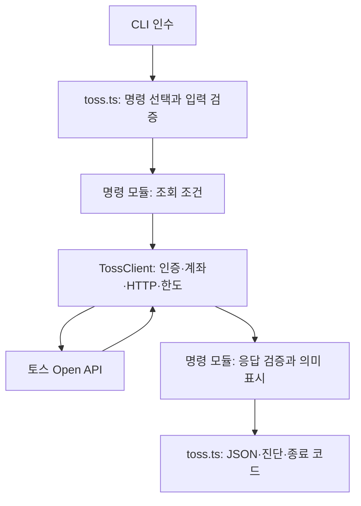

# 조회 CLI의 구조와 데이터 흐름

Stock Scout는 명령 하나를 실행하고 JSON 하나를 반환하는 TypeScript 로컬 CLI다. 외부 에이전트가 조회 순서와 분석·추천을 결정하며, CLI는 입력·응답 검증과 인증·계좌 선택·호출 제한을 담당한다. 실행 방법은 [시작 안내](getting-started.md), 외부 계약은 [CLI 레퍼런스](toss-cli.md), 수정 절차는 [개발 안내](development.md)를 따른다.

## 실행 흐름

[진입점](../scripts/toss.ts)은 명령을 선택하고 명령별 조건을 구성한 뒤 공통 클라이언트로 조회한다. 명령 모듈은 공급자 응답을 검증해 유효한 자료와 누락 이유·페이지 정보를 반환한다. 진입점은 출처와 조회 시각을 붙이고 민감한 출력이 없는지 검사한 뒤 JSON을 stdout에 출력한다. 오류 진단은 stderr로 출력한다.

`--help`는 클라이언트를 만들지 않고 명령 목록을 반환한다. `account-select`는 클라이언트의 보호 상태를 확인하고 선택 정보를 로컬에 저장하지만 HTTP 요청은 보내지 않는다. 일반 조회·도움말·계좌 선택의 출력 차이는 [공통 출력 계약](toss-cli.md)을 따른다.

## 모듈별 책임

| 모듈 | 책임 | 주요 검사 |
| --- | --- | --- |
| [toss.ts](../scripts/toss.ts) | 명령 발견·분기, 출처·결과 조립, 중단 신호와 안전한 오류 출력 | [공통 CLI](../tests/toss.test.mjs), [에이전트 소비](../tests/toss-agent-cli.test.mjs) |
| [toss-client.ts](../scripts/toss-client.ts) | 보호 상태, 토큰 발급·복구, 계좌 선택·범위, 커서 문맥, HTTP·한도·잠금 | [공통 CLI](../tests/toss.test.mjs), [시계](../tests/toss-clock.test.mjs), [응답·상태 크기](../tests/toss-auth-size.test.mjs), 계좌·주문 검사 |
| [toss-values.ts](../scripts/toss-values.ts) | 소수 문자열·시각·객체·심볼 검증과 유효 항목/누락 분류 | 명령별 공개 CLI 검사 |
| [toss-stock.ts](../scripts/toss-stock.ts) | 종목 식별과 모호한 후보의 선택 요구 | [종목](../tests/toss-stock.test.mjs) |
| [toss-discovery.ts](../scripts/toss-discovery.ts) | 순위와 거래 가능 종목 목록의 조건·집계 범위 | [탐색](../tests/toss-discovery.test.mjs) |
| [toss-prices.ts](../scripts/toss-prices.ts) | 가격 조회와 원천 시각 경과 시간 | [공통 CLI](../tests/toss.test.mjs), [보고 시점 소비](../tests/price-consumer.test.mjs) |
| [toss-market.ts](../scripts/toss-market.ts) | 호가와 최근 체결의 검증·공급자 순서 보존 | [시장 자료](../tests/toss-market.test.mjs) |
| [toss-candles.ts](../scripts/toss-candles.ts) | 봉 조건·응답, 거래일 선택, 순차 일봉 묶음 조립 | [봉](../tests/toss-candles.test.mjs), [날짜](../tests/toss-candle-date.test.mjs), [묶음](../tests/toss-candles-batch.test.mjs) |
| [toss-sessions.ts](../scripts/toss-sessions.ts) | 날짜·세션 검증과 문서상 거래 규칙·미확인 구분 | [세션·제약](../tests/toss-sessions.test.mjs) |
| [toss-account.ts](../scripts/toss-account.ts) | 보유와 통화별 현금 기반 매수 가능 금액 | [계좌](../tests/toss-account.test.mjs) |
| [toss-transactions.ts](../scripts/toss-transactions.ts) | 결제 기준 거래내역과 페이지 | [거래내역](../tests/toss-transactions.test.mjs) |
| [toss-orders.ts](../scripts/toss-orders.ts) | 일반·조건 주문의 조회 조건·상태·페이지 | [주문](../tests/toss-orders.test.mjs) |

모듈은 조회 조건과 결과의 의미를 담당하고, 인증이나 공유 파일 쓰기는 `TossClient`를 통한다. 모듈별 함수 배치는 내부 구현이며 외부 소비자의 계약은 CLI 입출력이다. 런타임은 Node.js 표준 모듈과 저장소의 TypeScript 모듈을 사용한다. 개발 의존성과 검사 범위는 [package.json](../package.json)과 [tsconfig.json](../tsconfig.json)에 있다.

## 공유 상태의 소유권

각 CLI 프로세스는 자신의 `TossClient`와 실행 예산을 가진다. 같은 보호 디렉터리를 쓰는 프로세스들은 디스크의 인증·호출 간격 상태를 공유한다. 상주 서버나 별도 요청 큐는 없다.

`TossClient`는 `TOSS_STATE_DIR`의 절대·정규 경로, 저장소 밖 위치, 디렉터리·파일 소유자와 권한을 확인한다. 파일 이름과 준비·복구 절차는 [보호 상태 계약](toss-cli.md)에 있다. 실제 비밀값이나 개인별 저장 위치를 이 문서에 기록하지 않는다.

| 잠금 | 보호하는 작업 |
| --- | --- |
| `issuance.lock` | 토큰 재확인과 필요한 발급·명시적 만료 복구 |
| `client.lock` | 상태 읽기·쓰기, 공유 호출 간격 예약, 다음 예약에 적용할 공급자 대기 기록 병합 |
| `account.lock` | 명시적인 기본 계좌 선택 저장 |

상태 저장은 새 임시 파일에 기록하고 동기화한 뒤 이름을 교체하는 방식이다. 응답별 공급자 대기 파일은 잠금 밖에서 게시하며 다음 잠금 소유자가 공유 상태에 병합한다. 발급 요청을 보내기 전에 `pending`을 기록하며, 발급 결과가 불명확하면 자동 재발급하지 않는다. 비정상 종료로 남은 잠금도 자동 삭제하지 않는다. 저장소 밖 파일이므로 Git 복원으로 복구할 수 없으며, 복구 전 실행 종료와 기존 상태 보존을 확인해야 한다.

공유 호출 간격은 부팅과 운영체제 시계 영역에 연결된 단조 시계를 사용한다. 실행 시간은 벽시계·프로세스 단조 시계·공유 시계의 남은 시간 중 가장 작은 값으로 제한한다. 시계 영역 불일치나 이전 상태 형식은 오류로 남기며 자동 초기화하지 않는다. 실행·HTTP 예산과 재시도 횟수의 값은 [CLI 레퍼런스](toss-cli.md)에서 관리한다.

## 계좌 조회와 출력 경계

계좌 조회는 저장된 별칭·선택 계좌·허용 명령 범위를 확인한 뒤 계좌 목록에서 선택 계좌의 유효성을 대조한다. 목록 요청에는 계좌 헤더를 붙이지 않고, 대상 자료 요청에 선택 계좌 헤더를 붙인다. 첫 계좌나 다른 계좌로 자동 대체하지 않는다.

다음 페이지 문맥은 계좌·자격 증명·조회 조건·공급자 커서를 HMAC으로 연결한다. 소비자는 반환된 `cursor`와 `context`를 함께 전달하며, 필터나 계좌가 바뀐 문맥을 재사용하지 않는다. 봉의 `nextBefore`는 이 계좌 커서와 다른 방식이다.

클라이언트는 비밀값과 계좌 식별자를 추적한다. 명령별 파서는 허용된 필드를 결과에 옮기고, 최종 출력에서 비밀값이 발견되면 정상 자료를 출력하지 않는다. 오류의 공급자 코드·요청 식별자도 형식 검증과 민감한 값 검사를 거친다. 이 로컬 범위 제한은 공급자가 강제하는 조회 전용 권한의 증거가 아니다. 접근·전달 허용과 남은 미확인은 [접근 기록](toss-access-readiness.md)을 따른다.

## 부분 결과와 묶음 조회

공통 항목 검증은 잘못된 항목을 `omissions`로 분리한다. 비어 있지 않은 응답에서 모든 항목이 무효하면 오류다. 정상 빈 배열은 자료 형식 오류와 구분한다. 페이지가 남거나 확인하지 못한 범위가 있으면 명령 모듈이 부분 결과를 표시한다.

`candles-batch`는 하나의 클라이언트로 요청 순서대로 각 종목의 일봉 한 페이지를 조회한다. `date` 선택 시 종목의 미국 시장 확인 요청도 같은 예산을 쓴다. 종목별 `success`·`partial`·`error`·`not_queried`와 요약·출처를 보존하고, 최상위 상태는 사용 가능한 종목 결과가 있는지를 반영한다. 정상 빈 페이지도 사용 가능한 결과다.

SIGINT·SIGTERM과 예산 초과를 처리할 수 있으면 완료한 종목을 반환한다. 진행 중 종목의 오류와 이후 미조회 종목은 구분한다. 강제 종료나 충돌 뒤 결과 복구·파일 저장·자동 재개는 제공하지 않는다. 소비자는 페이지와 종목별 상태를 확인해 후속 조회를 결정한다.

## 소비 예제와 검증 범위

[일봉 소비 예제](../examples/candle-consumer.mjs)와 [가격 소비 예제](../examples/price-consumer.mjs)는 CLI JSON을 stdin으로 받고 외부 호출 없이 계산·분류한다. 실행 절차와 해석 한계는 [에이전트 지침](toss-agent-usage.md)에 있다. 예제의 `Number` 계산은 금융 계산의 정밀도 보장이나 추천 알고리즘이 아니다.

공개 CLI 검사는 실제 하위 프로세스와 격리된 상태를 사용하고 외부 HTTP·필요한 시계를 대체한다. 테스트 정의와 실행 결과, 실제 토스 관측과 소비 환경 관측은 서로 다른 근거다. 현재 구현을 설명하는 이 문서가 과거 공급자 검증을 새로 수행한 결과를 뜻하지는 않는다. 전환의 이유와 당시 수용한 한계는 [ADR 0019](adr/0019-toss-query-tools-transition.md)와 [전환 기록](toss-transition.md)에 있다.
